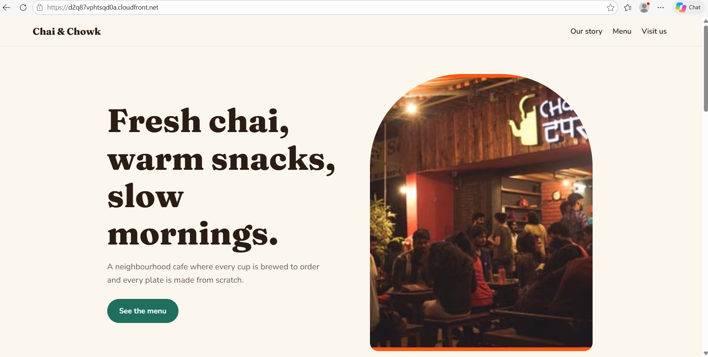
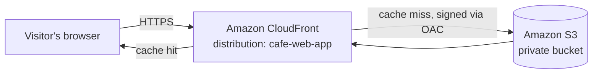
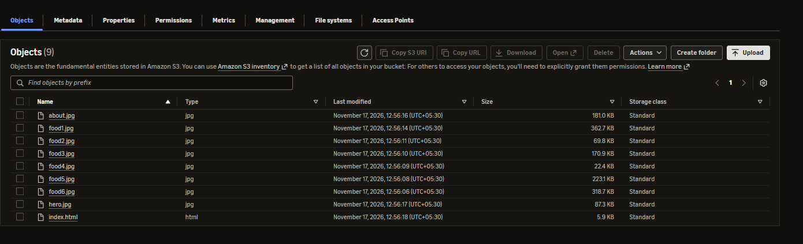
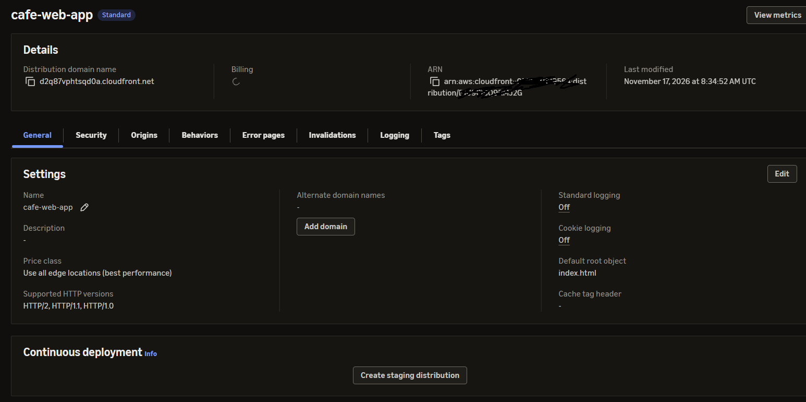
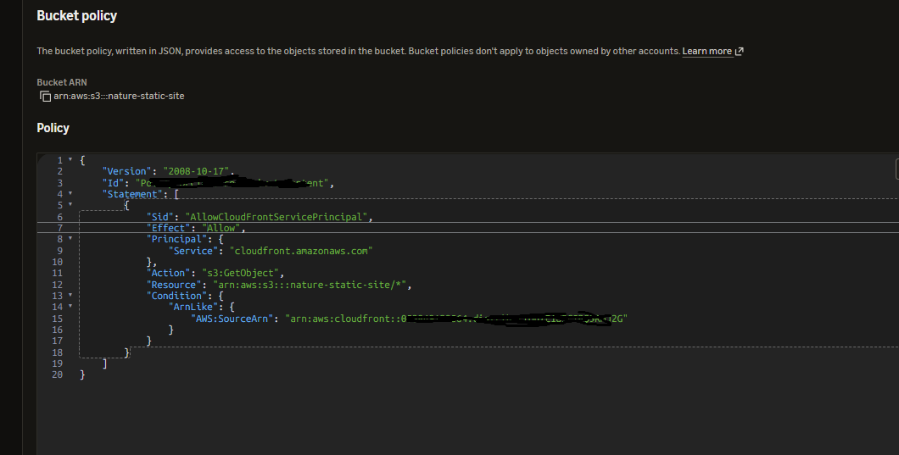
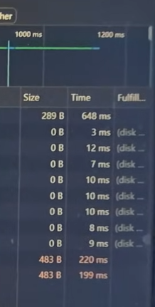

# Chai & Chowk: Static Website on AWS S3 + CloudFront


-success)

A responsive single-page website for a fictional neighbourhood cafe, **Chai & Chowk**, hosted on **Amazon S3** and delivered globally through **Amazon CloudFront**. The S3 bucket stays fully private. Only CloudFront can read from it, using Origin Access Control (OAC).

The project shows a standard, production-style pattern for static hosting on AWS: private origin, CDN in front, HTTPS by default, and low-cost, low-maintenance infrastructure.

**Live demo:** https://d2q87vphtsqd0a.cloudfront.net



---

## Table of Contents

- [Architecture](#architecture)
- [Features](#features)
- [Tech Stack](#tech-stack)
- [Project Structure](#project-structure)
- [AWS Configuration](#aws-configuration)
- [Deployment Guide](#deployment-guide)
- [Verifying Caching](#verifying-caching)
- [Customising the Site](#customising-the-site)
- [Updating the Site](#updating-the-site)
- [Security Notes](#security-notes)
- [Cleanup](#cleanup)
- [Future Improvements](#future-improvements)

---

## Architecture



1. A visitor requests the CloudFront domain.
2. CloudFront serves the object from the nearest edge location if it is cached.
3. On a cache miss, CloudFront fetches the object from the private S3 bucket using OAC and caches it for later requests.
4. Direct access to the S3 bucket is not possible. The bucket policy only trusts this specific CloudFront distribution.

## Features

- **Fast global delivery:** content is cached at CloudFront edge locations (price class: *Use all edge locations*).
- **Private origin:** the S3 bucket has no public access. It is reachable only through CloudFront.
- **HTTPS out of the box:** served on the default `*.cloudfront.net` certificate.
- **Responsive design:** CSS Grid layout that adapts to mobile, tablet and desktop.
- **Dark mode:** automatically follows the visitor's `prefers-color-scheme` setting.
- **Accessible:** visible focus states, `alt` text on all images, and reduced-motion support.
- **No build step:** plain HTML and CSS, with nothing to compile or install.

## Tech Stack

| Layer | Technology |
| --- | --- |
| Frontend | HTML5, CSS3 (custom properties, Grid, Flexbox) |
| Fonts | Google Fonts: Fraunces, Nunito |
| Storage | Amazon S3 |
| CDN | Amazon CloudFront with Origin Access Control |

## Project Structure

```
.
├── index.html          # Single-page site (markup + inline CSS)
├── hero.jpg            # Hero banner image
├── about.jpg           # "Our story" section image
├── food1.jpg           # Menu images (food1 to food6)
├── ...
├── food6.jpg
├── docs/
│   └── screenshots/    # Screenshots used in this README
└── README.md
```

## AWS Configuration

### S3 bucket

All site files sit at the root of the bucket: `index.html` plus the 8 images, 9 objects in total.



### CloudFront distribution

| Setting | Value |
| --- | --- |
| Distribution name | `cafe-web-app` |
| Origin | Private S3 bucket (via OAC) |
| Default root object | `index.html` |
| Price class | Use all edge locations (best performance) |
| HTTP versions | HTTP/2, HTTP/1.1, HTTP/1.0 |



### Bucket policy

The policy below lets the CloudFront service principal read objects, but only when the request comes from this specific distribution. Replace the placeholders with your own values.

```json
{
  "Version": "2008-10-17",
  "Id": "PolicyForCloudFrontPrivateContent",
  "Statement": [
    {
      "Sid": "AllowCloudFrontServicePrincipal",
      "Effect": "Allow",
      "Principal": {
        "Service": "cloudfront.amazonaws.com"
      },
      "Action": "s3:GetObject",
      "Resource": "arn:aws:s3:::<YOUR_BUCKET_NAME>/*",
      "Condition": {
        "ArnLike": {
          "AWS:SourceArn": "arn:aws:cloudfront::<YOUR_ACCOUNT_ID>:distribution/<YOUR_DISTRIBUTION_ID>"
        }
      }
    }
  ]
}
```



## Deployment Guide

### Prerequisites

- An AWS account
- The files from this repository

### Steps

1. **Create an S3 bucket**
   - Open S3 → *Create bucket* and choose a globally unique name.
   - Keep **Block all public access** turned **on**.

2. **Upload the site files**
   - Upload `index.html` and all `.jpg` images to the bucket root.

3. **Create a CloudFront distribution**
   - Open CloudFront → *Create distribution*.
   - Choose the S3 bucket as the origin and select **Origin access control (OAC)**.
   - Set **Default root object** to `index.html`.
   - Choose your preferred price class and create the distribution.

4. **Apply the bucket policy**
   - CloudFront offers to generate the policy during setup. Copy it into S3 → *Permissions* → *Bucket policy*.
   - Or use the JSON in [Bucket policy](#bucket-policy) with your own bucket name, account ID and distribution ID.

5. **Wait for deployment**
   - Wait until the distribution status changes from *Deploying* to a **Last modified** date.

6. **Open the site**
   - Visit `https://<distribution-domain>.cloudfront.net`.

## Verifying Caching

Open your browser's DevTools → **Network** tab and reload the page to confirm that content is being cached.

**Initial load:** the HTML document takes ~648 ms, and the images are fetched over the network or revalidated.



**Repeat load:** the HTML document drops to ~131 ms, and the images are served straight from the browser's memory cache at **0 ms / 0 B** transferred.


> Browser caching and CloudFront edge caching work together. The browser avoids repeat downloads, and CloudFront avoids repeat trips to S3.

## Customising the Site

- **Images:** replace `hero.jpg`, `about.jpg` and `food1.jpg` to `food6.jpg` with your own, keeping the same file names. If you use `.png`, update the extensions in `index.html`.
- **Menu items and prices:** edit the `<article class="item">` blocks in the `#menu` section.
- **Contact details:** update the address, hours and phone number in the `#visit` section.
- **Colours:** change the CSS variables in `:root` (light theme) and the `prefers-color-scheme: dark` block.

## Updating the Site

CloudFront caches objects, so changes may not appear right away. After uploading new files to S3, create an invalidation:

1. CloudFront → your distribution → **Invalidations** → *Create invalidation*.
2. Enter the paths to refresh, e.g. `/index.html` or `/*`.

Or use the AWS CLI:

```bash
aws s3 sync . s3://<YOUR_BUCKET_NAME> --exclude "docs/*" --exclude "README.md" --exclude ".git/*"
aws cloudfront create-invalidation --distribution-id <YOUR_DISTRIBUTION_ID> --paths "/*"
```

## Security Notes

- The S3 bucket is **not public**. Objects are only readable through the CloudFront distribution named in the bucket policy.
- The policy grants **read-only** access (`s3:GetObject`) and nothing else.
- Traffic between visitors and CloudFront is encrypted over HTTPS.
- Never commit AWS access keys or secrets to this repository.
- If you publish screenshots of the AWS console, consider blurring your account ID and distribution ARN.

## Cleanup

To avoid ongoing charges, delete the resources when you no longer need them:

1. Disable, then delete the CloudFront distribution.
2. Empty, then delete the S3 bucket.

## Future Improvements

- Add a custom domain with an ACM certificate and Route 53
- Add security response headers (HSTS, CSP) via a CloudFront response headers policy
- Enable CloudFront standard logging for traffic insights
- Automate deployment with GitHub Actions (S3 sync + cache invalidation)
- Define the infrastructure as code with Terraform or AWS CDK
- Compress and convert images to WebP/AVIF for faster loads

---

© 2026 Chai & Chowk Cafe. A demo project for learning static hosting on AWS.
